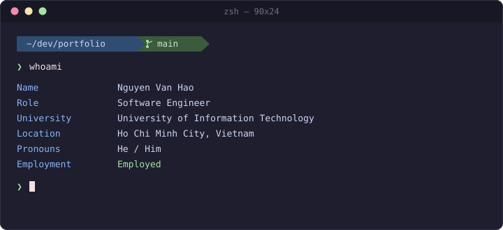
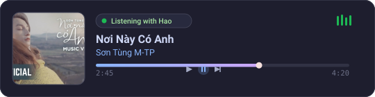

  

&nbsp;
&nbsp;

## About Me

<table>

<tr>

<td width="60%" valign="top">

</td>

<td width="40%" align="center" valign="middle">

<i>I like Usagi</i>

</td>

</tr>

</table>

---

## 🛠️ Tech Stack

**Languages**

   

**Frontend**

   

**Backend**

  

**Database & Tools**

         

---

## 🎵 Listen With Me

  

---

## 🐍 Contribution Graph

<picture>
  <source media="(prefers-color-scheme: dark)" srcset="https://raw.githubusercontent.com/HaoRonald/HaoRonald/output/github-contribution-grid-snake-dark.svg">
  <source media="(prefers-color-scheme: light)" srcset="https://raw.githubusercontent.com/HaoRonald/HaoRonald/output/github-contribution-grid-snake.svg">
  
</picture>

---

 

